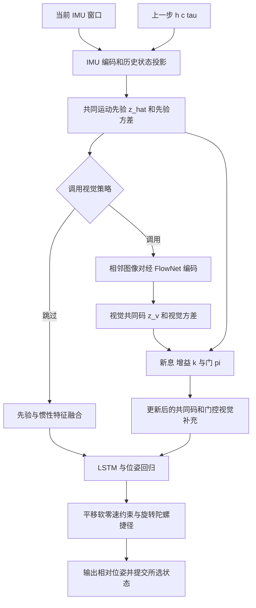

# PCM v3 架构与交接说明

交接日期为 2026 年 11 月 13 日。接手者首先复现地面数据 checkpoint 的固定测评，再改动模型。当前研究目标仍是提高视觉与惯性融合的精度、退化鲁棒性和视觉计算效率；已有结果只证明部分改进，不能将三者都表述为已解决。

## 当前实现与入口

| 文件 | 职责 |
| --- | --- |
| `crvio/vio.py` | `PCMVIO` 骨干、状态管理、策略、训练双候选和真实跳过视觉的推理 |
| `crvio/pcm.py` | 共同运动先验、视觉观察、方差、增益、门控、新息与互补融合 |
| `crvio/pcm_losses.py` | 运动读出监督、方差校准、共同预测、静止和融合损失 |
| `crvio/losses.py` | 两阶段总目标与视觉可用性日程 |
| `crvio/recipe.py` | AdamW、EMA、速度均衡、静止增强、陀螺仪映射 |
| `crvio/config.py` | 唯一预设 PCM3、默认参数、checkpoint 配置加载 |
| `crvio/perturb.py` | 视觉和 IMU 测量扰动 |
| `crvio/evaluation.py` | 按序列连续推理、对照策略、验证集阈值标定 |
| `tools/benchmark.py` | 固定测试组合、配置校验、运行记录和分组汇总 |
| `tools/pcm_diag.py` | 拒绝视觉、冻结图像、替换 IMU、静止与方差诊断 |

## 模型的数据流



输入为相邻 RGB 图像对与区间内的 11 个 IMU 样本。图像为 256×512；IMU 有六个测量通道和一个样本可用性掩码，每帧区间推进 10 个 IMU 样本。一个训练窗口为 11 张图像，即 10 个区间。输出顺序是三个欧拉角和相机坐标系下的三维相对平移。全局轨迹由相对位姿累积得到。

视觉编码复用 FlowNet 骨干，输出 512 维；惯性编码输出 256 维。历史 LSTM 顶层隐藏状态从 1024 维投影到 128 维，与 IMU 特征合并成 `x_i`；视觉特征投影为 `x_v`，两者各 256 维。

共同码总计 56 维，按旋转 16、平移 32、静止 8 分块，自由块为 0。IMU 与历史状态预测 `z_hat`；静止子块专门只读取当前 IMU 特征，避免历史运动状态延续成停车漂移。视觉分支产生 `z_v`。两端共享线性运动读出头，并用训练集确定的 `b_R`、`b_d` 归一化监督。

当前实现已经区别于最早的 B2–B7 设计：没有旧条件残差解释器、旧共同码归一化对齐、旧方差头 s。不要按照旧 README 或最初设计稿解释 PCM3。

## 新息与门控融合

每个旋转或平移块分别预测一个方差。先验方差为 `exp(logvar_base) + softplus(q_raw) * steps`，其中 `steps` 为距上次视觉调用的区间数。送入网络的时间特征截断到 9 个区间，但方差增长项不截断。

新息为 `eps = z_v - z_hat - EMA_mean(eps)`。增益与门定义为：

```text
k   = sigmoid(alpha * (logvar_p - logvar_v) + beta)
NIS = mean((W_block * eps_block)^2) / (var_p + var_v)
pi  = sigmoid(a - softplus(c_raw) * NIS)
g   = pi * k
mu  = z_hat + expand(stop_gradient(g)) * eps
f   = Phi([mu, x_i, stop_gradient(g_trans) * x_v])
```

`Phi` 的输入为 568 维，隐藏宽度 1244，输出 768 维，再进入两层、隐藏维度 1024 的 LSTM 和 6 维位姿回归头。没有视觉时 `mu=z_hat`，视觉补充槽为零。增益和门不是经过验证的传感器可信概率，当前冻结图像上的平移门几乎一直打开。

`p_still` 从融合共同码的静止块读出，经 5% 静止先验的 Bayes 校正，再以停止梯度的 `(1-p_still)` 缩放平移输出。旋转输出另加经可学习 3×3 映射的区间陀螺积分，映射从训练集最小二乘拟合初始化。

## 策略与状态不变量

策略读取 `z_hat`、上一步顶层隐藏状态、两个先验对数方差和时间特征；为兼容 checkpoint，方差信号槽补四个零。策略在读取当前图像前作决定，默认所有策略输入停止梯度。

训练可计算两条候选路径，推理只有调用时才运行视觉编码。两候选都从同一个 `(h,c)` 出发；只提交所选路径的状态，不能在无视觉状态上再次推进同一区间。状态为 `(h,c,tau)`，`tau` 按是否调用视觉清零，与门是否接受视觉无关。序列首区间强制使用视觉，后续分块之间延续状态；训练窗口则重新初始化状态。

`tests/data/pcm3_state_keys.json` 固定权重名称、顺序和形状。更改模块注册顺序也可能破坏优化器断点恢复。PCM v1/v2 和 B 系列 checkpoint 被明确拒绝，需要对应旧快照。

## 两阶段训练

第一阶段同时监督有视觉与无视觉候选。无视觉监督从窗口第二个区间开始，避免要求零状态下只凭短 IMU 恢复未知初速。视觉可用性采用连续屏蔽日程，包含只在首区间使用视觉的窗口。

第二阶段继续以两候选监督约束估计器，再通过直通 Gumbel 选择和候选误差训练策略。视觉编码器冻结，策略学习率 1e-4、估计器 1e-5，视觉成本系数动态调整到目标使用率 25%。它仍需要真实数据训练和固定预算比较；交接的两份 v3 权重只完成第一阶段。

| 目标 | 训练对象和边界 |
| --- | --- |
| 位姿 MSE | `100 * angle_MSE + translation_MSE`，监督候选回归和表示 |
| 共同运动读出 | 视觉与先验的归一化旋转、平移，权重 0.05 |
| 方差 NLL | 只训练方差头和先验增长参数 q，特征及读出误差停止梯度；权重 1e-3 |
| 共同预测 L_x | 先验预测停止梯度的视觉共同码，以 EMA 方差归一化并按跳过长度分桶；kappa_x=0.2 |
| 静止 BCE | 两端共享静止读出，类别平衡；kappa_still=0.1 |
| 融合读出 L_fuse | 只训练增益修正和门参数；编码、读出头停止梯度；权重 0.05 |

共同预测与静止项采用相对位姿损失的自适应权重，不能把 kappa 当固定的损失乘数。估计器位姿损失不直接打开门；融合损失才更新门和增益参数。

固定训练配方为 batch 32、阶段一峰值学习率 3.5e-4、AdamW、EMA 0.9995、1 epoch warmup 后 cosine 降至峰值 1%、梯度裁剪 1、速度均衡采样、5% 静止增强、混合测量扰动以及视觉编码器 bf16。地面阶段一 40 epoch；KITTI 60 epoch。第二阶段固定 40 epoch。不得在续训时修改原 cosine 总长度来延长同一次实验。

## 交接包与权重

根目录：`/remote-home/share/ums_lzj/PCM-VIO_handoff_20261113`。

| 相对路径 | 内容 |
| --- | --- |
| `checkpoints/pcm3_g/stage1_last.pth` | 完整 v3，seed 0，40 epoch 的最终权重 |
| `checkpoints/pcm3_nox_g/stage1_last.pth` | 同配方，只有 kappa_x=0 的训练消融 |
| `checkpoints/*/options.json` | 从对应 checkpoint 导出的完整配置 |
| `checkpoints/manifest.json` | 文件 SHA256、版本、stage、epoch 与配置 |
| `data_ground.tar` | 本轮使用的已转换数据独立归档，含转换元数据；解包到本地 `data/` |
| `data_kitti/` | IMU 独立副本；图像与 poses 指向现有共享 KITTI，详见本包说明 |
| `pretrain_models/` | FlowNet 初始化权重 |
| `evidence/` | 最新训练日志、逐序列原始结果、轨迹、诊断 |
| `legacy/` | 原始实验历史与旧代码快照，用于解释和重测旧实验 |
| `source/` | 与 GitHub 提交一致的当前代码和文档 |
| `SHA256SUMS` | 本包普通文件校验表；不沿 KITTI 外部软链接遍历 |

两份最终 checkpoint 各约 773 MiB，包含 `model`（评测用 EMA）、`model_raw`、优化器、随机数状态、stage/epoch 和 opt。`epoch=39` 表示已经完成 40 epoch。使用 `stage1_last`，不要改用验证集偶然更好的 `stage1_best`。第一阶段保存的策略尚未训练，不能直接用默认 learned policy 报告结果。

原始实验不动，仍保留在 `/root/VIO/Visual-Selective-VIO`。新工作目录为 `/root/VIO/PCM-VIO`。交接代码的模型和损失来自已训练的 v3，整理只涉及文档、运行入口、测评记录和路径可迁移性。

## 接手运行

```bash
export BUNDLE=/remote-home/share/ums_lzj/PCM-VIO_handoff_20261113
export GROUND_DATA="$PWD/data/data_ground"
unset PYTHONPATH
export OMP_NUM_THREADS=4 MKL_NUM_THREADS=4

# 首次运行解包；后续可复用本地副本。
mkdir -p data
tar -xf "$BUNDLE/data_ground.tar" -C data

# 先复现完整 v3，再用相同命令测消融 checkpoint，另起输出名。
python tools/benchmark.py --dataset ground --gpu 0 --name pcm3_reproduce \
  --ckpt "$BUNDLE/checkpoints/pcm3_g/stage1_last.pth" --data-dir "$GROUND_DATA"

# 机制诊断，必须保留全部区间。
VIO_SEG_LENGTHS=5,10,15,20 python tools/pcm_diag.py \
  --ckpt "$BUNDLE/checkpoints/pcm3_g/stage1_last.pth" --data_dir "$GROUND_DATA" \
  --gpu 0 --out results/pcm3_reproduce/diag.json

# 重建训练缓存；测试仍走 PIL 图像读取路径。
python tools/cache_images.py --data_dir "$GROUND_DATA" --out cache/ground_256x512

# 重新训练完整 v3；复制命令改 seed 为 1、2，消融另外增加 --kappa_x 0。
DATA_DIR="$GROUND_DATA" IMG_CACHE="$PWD/cache/ground_256x512" \
FLOWNET="$BUNDLE/pretrain_models/flownets_bn_EPE2.459.pth.tar" \
scripts/ground_arm.sh PCM3 pcm3_seed1 0 --seed 1
```

从交接权重开始地面第二阶段，是新实验而非延长第一阶段：

```bash
VIO_SEG_LENGTHS=5,10,15,20 python train_crvio.py --preset PCM3 --stage 2 \
  --pretrain "$BUNDLE/checkpoints/pcm3_g/stage1_last.pth" \
  --data_dir "$GROUND_DATA" --img_cache cache/ground_256x512 \
  --train_seq m2_bridge2 m2_street1 m2_switch m3_dynamic01 m3_shaturn01 m3_wheelfloat01 \
  --val_seq m2_tree --test_seq m2_building2 m2_street2 m3_varyingillu01 m3_occlusion01 \
  --dt 0.0666667 --epochs_stage1 40 --epochs_stage2 40 --batch_size 32 --workers 8 \
  --lr_stage1 3.5e-4 --amp bf16 --seed 0 --gpu 0 --experiment_name pcm3_ground_stage2
```

`--pretrain` 读取评测用 EMA，开启新阶段；`--resume` 用于中断的同一实验，并恢复 raw 权重、优化器、随机数。CLI 不会自动完整恢复 checkpoint 的所有配置，所以 resume 时必须重放原命令与原 epoch 数。消融继续训练必须保留 `--kappa_x 0`。

## 优先工作

1. 先用交接权重与数据复现，确认完整 v3 全视觉主表 t_rel 约 7.13%，随机 25% 约 9.91%。
2. 针对冻结图像分析 L_fuse 的梯度、平移读出和门参数，为何 pi_trans 约 0.995。用验证序列做开发，保持本次测试结果作为已知历史结果。
3. 让训练覆盖更长的无视觉状态演化，区分窗口重置、时间截断、先验方差增长和软零速约束的影响。
4. 在 seed 0/1/2 上比较完整 v3 与 nox，报告训练种子波动；再推进第二阶段与 KITTI。
5. 新增策略需和相同预算的 random、interval、去掉方差信号策略比较，并测真实总耗时。

当前数据已经被多轮观察和迭代使用，不能将未来在同一测试集反复调参后的增益称为完全独立的泛化证据。后续正式结论应增加未参与开发的数据或预先固定的新评估协议。
